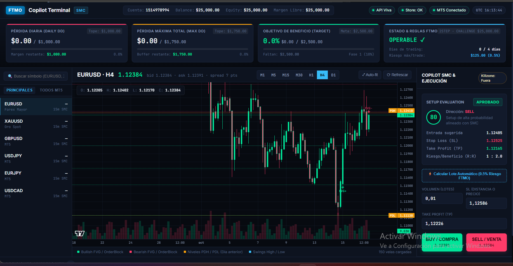

# FTMO Copilot Dashboard



Dashboard local que analiza **EURUSD** y **XAUUSD** en **MetaTrader 5**, detecta
setups de **Smart Money Concepts (SMC)** en M15, les pone un **Setup Score**,
propone entrada / SL / TP y **avisa** (nunca ejecuta solo). Todo queda registrado
en SQLite para auditar después.

Pensado para cuentas de prop firm **FTMO** (1-Step o 2-Step de 25.000 $), pero
funciona con cualquier cuenta de MetaTrader 5.

> **Aviso**: es una herramienta de análisis y ayuda a la decisión. No hay
> auto-ejecución: la orden la confirma siempre una persona. No es asesoramiento
> financiero. Operar con apalancamiento implica riesgo de pérdida total.

---

## Cómo funciona

1. **Datos** — `adapters/mt5/` se conecta a tu terminal MT5 y lee velas M15 y el
   tick actual de cada símbolo.
2. **Patrones** — `core/smc_engine.py` detecta Fair Value Gaps, Order Blocks y
   barridos de máximos/mínimos (sweeps) sobre las velas. Solo zonas **vivas**
   (sin mitigar).
3. **Niveles** — `core/levels.py` dibuja soportes/resistencias: swings
   confirmados, rango del día anterior (PDH/PDL) y números redondos.
4. **Score** — `core/risk_engine.py` puntúa cada dirección (BUY/SELL) de 0 a 100:
   **85 % patrones SMC + 15 % sesión (killzone)**.
5. **Veredicto** — `core/setup_gate.py` aprueba el setup si el score supera el
   umbral, hay zona de entrada alcanzable, el SL está definido y la R:R es
   válida; y devuelve el plan (entrada, SL, TP).
6. **Aviso y registro** — el panel lo muestra, `POST /api/watcher/scan` evalúa y
   audita, y tú confirmas la orden desde el dashboard. Queda todo en
   `database/trading.db`.

La lógica de decisión vive en `core/` (puro, sin I/O ni MT5), lo que hace que
sea testeable sin terminal: **534 tests** en verde con `python -m pytest`.

---

## Requisitos

- **Windows** (el paquete `MetaTrader5` de Python solo existe para Windows).
- **Python 3.12+**.
- **MetaTrader 5** instalado y una cuenta (demo o real) abierta o disponible.
- Una cuenta **FTMO** (challenge/evaluación) o cualquier bróker MT5.

---

## Instalación

```powershell
# 1. Dependencias
pip install -r requirements.txt

# 2. Tu configuración local (PowerShell)
Copy-Item .env.example .env
```

Edita `.env` (ver siguiente sección). **`.env` nunca se sube a git**: ya está en
`.gitignore` y guarda tu contraseña.

---

## Configuración (`.env`)

| Variable | Qué poner |
|----------|-----------|
| `MT5_LOGIN` | Tu número de cuenta, **sin comillas y como número** (`123456789`, no `"123456789"`). |
| `MT5_PASSWORD` | Tu contraseña de MT5. |
| `MT5_SERVER` | Nombre **exacto** del servidor de tu bróker, tal como aparece en el terminal (p. ej. `FTMO-Demo`). Es el fallo más frecuente. |
| `MT5_PATH` | Ruta a `terminal64.exe` si tu terminal no está en la ubicación por defecto. |
| `FTMO_PROFILE` | `ftmo_1step_25k` o `ftmo_2step_25k` — **el de TU cuenta**. Define los topes de drawdown. |
| `API_TOKEN` | Opcional. Si lo pones, las peticiones que escriben (`/scan`, `/trade`, cierres) exigen la cabecera `x-api-token` o `Authorization: Bearer <token>`. Vacío = modo local sin auth. |
| `HOST` / `PORT` | Por defecto `127.0.0.1:8000`. |
| `DEBUG` | `true` recarga al guardar (solo desarrollo). |
| `GEMINI_API_KEY` | Opcional. El chat con IA está previsto pero **aún no conectado**. |
| `FTMO_DATA_ROOT` | Opcional. Carpeta para datos pesados (capturas). Por defecto `~/Desktop/ftmo_data`, fuera del repo y de OneDrive. |

### Tu cuenta no aparece en el repo

Los números de cuenta **no se versionan**. El mapeo cuenta → perfil se resuelve
en runtime desde el `.env` (`MT5_LOGIN` + `FTMO_PROFILE`), tal como explica el
propio `config/prop_profiles.yaml`. Si prefieres fijar una cuenta para todos,
puedes añadirla en el bloque `accounts:` de ese fichero.

---

## Arranque

```powershell
python app.py
```

Abre **http://127.0.0.1:8000** en el navegador. La API interactiva está en
**http://127.0.0.1:8000/api/docs**.

### Comprobar que conecta

- El panel de cuenta muestra balance y equity reales (una demo FTMO de 25.000 $).
- O en PowerShell:

```powershell
Invoke-WebRequest http://127.0.0.1:8000/api/market/account -UseBasicParsing
```

### Errores típicos

| Síntoma | Causa |
|---------|-------|
| `-6 Authorization failed` | Contraseña o **servidor** incorrectos. |
| `-2 Invalid "login" argument` | `MT5_LOGIN` con comillas o texto: tiene que ser un número. |
| `503` en `/api/prop/state` | Falta el perfil: revisa `FTMO_PROFILE` en `.env`. |
| `404` en `/api/market/price` | El bróker no publica ese símbolo en tu cuenta. |
| Puerto ocupado | Hay otra instancia de `python app.py` abierta: ciérrala. |

---

## Tests

```powershell
python -m pytest
```

534 tests: `core/` puro, servicios, endpoints y dobles de MT5 (no toca el
terminal real ni la `trading.db` de producción).

---

## La estrategia

### Qué hay hoy: una sola, SMC + killzone

Es determinista (sin IA en la decisión): mismos datos, mismas reglas, mismo
resultado.

| Regla | Valor |
|-------|-------|
| Componentes del score | 85 % SMC (FVG, Order Blocks, sweeps) + 15 % killzone |
| Umbral de aprobación | `score.min_score: 59.5` |
| R:R mínima / objetivo | 2.0 / TP = 2 × R |
| Stop loss | Por símbolo, en unidades de precio: EURUSD `0.0012`, XAUUSD `3.0` |
| Riesgo por operación | 0.5 % del capital fijo (0.25 % en escalón reducido) |
| Operaciones al día | Máximo 3 |
| Sesiones (UTC) | Londres 07:00–10:00, Nueva York 12:30–15:30 |
| Símbolos / temporalidad | EURUSD y XAUUSD en M15 |
| Vigencia de un setup | 40 minutos (`score.setup_ttl_minutes`) |
| Watcher | Escaneo manual con `POST /api/watcher/scan` cada 30 s recomendados; **nunca auto-ejecuta** (`POST /api/watcher/auto-execute` responde 501) |

### Cómo configurarla

Todo está en **`config/strategy.yaml`** — una sola fuente de verdad. Se lee con
cada petición, así que **basta con guardar el fichero; no hace falta reiniciar**.

Claves principales:

```yaml
risk:
  risk_pct: 0.5              # % del capital fijo por operación
  reduced_risk_pct: 0.25     # escalón reducido
  max_trades_day: 3

execution:
  sl_distance: 0.0012                 # SL global, en unidades de precio
  sl_distance_by_symbol:              # manda sobre el global
    EURUSD: 0.0012
    XAUUSD: 3.0
  tp_ratio_r: 2.0                     # objetivo = 2 × R
  deviation_points: 15
  symbols_allow: ["EURUSD", "XAUUSD"] # lista blanca; vacía = todo permitido
  magic: 8882026                      # identifica órdenes de ESTE copiloto

score:
  min_score: 59.5             # umbral de aprobación
  min_rr: 2.0                 # R:R mínima exigida
  setup_ttl_minutes: 40
  weights:
    smc: 85.0
    killzone: 15.0

killzones:                    # horario UTC, sin DST
  - {name: Londres, start: '07:00', end: '10:00'}
  - {name: Nueva York, start: '12:30', end: '15:30'}
```

Ejemplos rápidos:

- **Más permisivo**: baja `score.min_score` (p. ej. `50`).
- **Más estricto**: súbelo, o sube el peso de `smc` y baja el de `killzone`.
- **Otro par**: añade su entrada a `symbols` **y** su `sl_distance_by_symbol`
  (sin distancia de SL el setup se rechaza) y, si procede, a `symbols_allow`.
- **Otra sesión**: cambia los rangos de `killzones` (en UTC, no en hora local).

Si la clave no existe, se ignora; si el **tipo o el rango** están mal (p. ej.
`min_score: 200` o `risk_pct: "algo"`), la API responde **400** con el motivo:
nunca se ejecuta con reglas rotas en silencio. Los valores por defecto están en
`core/strategy.py::DEFAULTS`.

### ¿Se puede usar o añadir otra estrategia?

Hoy el alcance está **congelado** (`docs/ALCANCE.md`): existe una sola
estrategia y **no hay selector ni sistema de plugins**. `strategy.yaml`
describe UNA estrategia; más de una requeriría decisiones de diseño que el
proyecto ha pospuesto a propósito.

Si quieres ampliarlo, el camino real (por el que está hecho el código) es:

1. **Decisión nueva** en `.agent/DECISIONS.md` + entrada en `docs/ALCANCE.md`.
2. **Módulo puro nuevo en `core/`**: recibe datos ya normalizados, devuelve
   resultados deterministas. Sin I/O, sin MT5, sin red (lo vigila
   `tests/unit/test_core_purity.py`).
3. **Conecta el score** en `score.weights` (si su componente tiene feed real:
   un peso sin dato solo aplana el score) o dale su propia puerta de entrada en
   `core/setup_gate.py`.
4. **Publica el resultado** en el snapshot (`api/services/market.py`) y, si la
   UI lo necesita, en `/api/chart/setup-eval`.
5. **Tests** primero: `python -m pytest` en verde antes de marcar nada como
   terminado.

Lo que hoy es fácil cambiar sin tocar código: pesos, umbral, killzones, SL/TP,
riesgo, símbolos, temporalidad y límites del watcher — todo por YAML.

---

## Estructura del proyecto

```
ftmo_dashboard/
├── app.py               # punto de entrada: python app.py
├── config/              # strategy.yaml, prop_profiles.yaml, symbols.yaml
├── core/                # lógica PURA (sin I/O ni MT5): score, gate, SMC, riesgo
├── adapters/            # única capa que habla con MetaTrader 5
├── api/                 # FastAPI: rutas delgadas + servicios
├── settings/            # I/O de la configuración (lectura de los YAML)
├── database/            # SQLite: esquema, store y trading.db (no versionada)
├── static/              # frontend (index.html + Lightweight Charts)
├── tests/               # 534 tests (unit + integration)
└── docs/                # ALCANCE.md y captura del dashboard
```

Reglas del proyecto: `core/` es puro (lo comprueba `test_core_purity.py`), I/O
solo en `adapters/`, `settings/`, `services/` y `api/`, y las rutas son siempre
absolutas desde `core/paths.py`.

---

## API (resumen)

Todas las respuestas son JSON; la lista completa está en `/api/docs`.

| Método | Ruta | Qué hace |
|--------|------|----------|
| GET | `/api/health` | Estado del proceso y de sus cables |
| GET | `/api/config/summary` | Resumen de la config para la UI |
| GET | `/api/market/symbols` | Símbolos visibles de la cuenta |
| GET | `/api/market/price?symbol=EURUSD` | Bid/ask actual |
| GET | `/api/market/analysis?symbol=...` | Patrones SMC + niveles |
| GET | `/api/market/candles?symbol=...` | Velas del timeframe |
| GET | `/api/market/account` | Cuenta (balance, equity, apalancamiento) |
| GET | `/api/market/positions` | Posiciones abiertas |
| GET | `/api/chart/setup-eval?symbol=...` | Plan completo de setup (entry/SL/TP y motivos) |
| GET | `/api/prop/state` | Topes FTMO y drawdown del día |
| GET | `/api/watcher/status` | Qué vigila el watcher y su config |
| POST | `/api/watcher/scan` | Ejecuta un ciclo de evaluación y lo audita |
| POST | `/api/trade/market` | Abre una orden (la confirma la persona) |
| POST | `/api/positions/{ticket}/close` | Cierra una posición |
| GET | `/api/positions` | Posiciones de esta cuenta |

---

## Persistencia y datos

- **`database/trading.db`** — auditoría (setup_log, operaciones, marcas).
  Se regenera el esquema desde `database/schema.sql`; **no se versiona**.
- **Datos pesados** (capturas post-operación) en `FTMO_DATA_ROOT`
  (`~/Desktop/ftmo_data` por defecto), fuera del repo y de OneDrive.
- **`trading.db` de producción**: los tests no la tocan; hay un canario que
  falla la suite si algún test la modifica.

---

## Límites conocidos

- El **chat con IA** (Gemini vía litellm) está decidido en el alcance pero
  **aún no está conectado**; por eso `GEMINI_API_KEY` no hace nada todavía.
- La capa `volume_profile` de niveles está declarada en la config pero no se
  calcula aún.
- El **Best Day Rule** del perfil 1-Step se calcula y **avisa** en
  `/api/prop/state`, pero no bloquea operaciones (es un requisito de aprobación,
  no de intradía).
- Un solo proceso de dashboard por terminal MT5.

---

## Licencia

[MIT](LICENSE) — © Trinity 2026.
